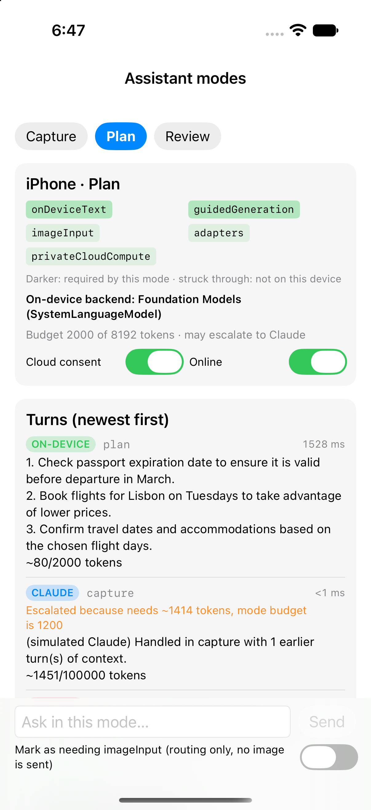
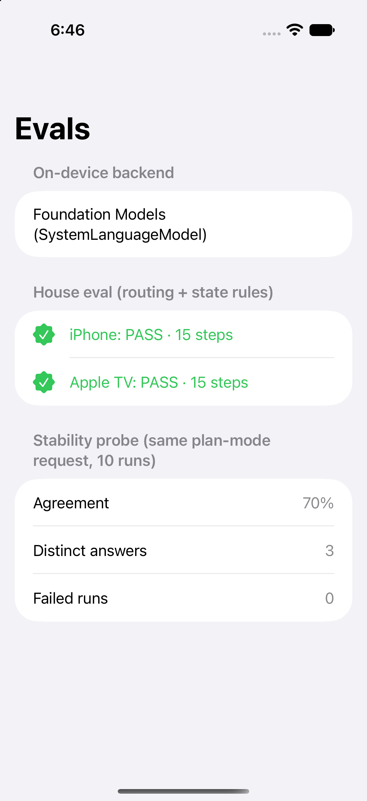
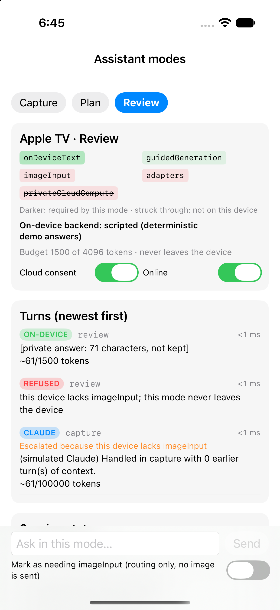
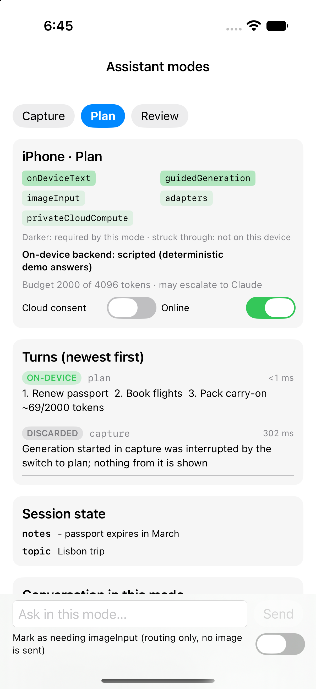

# AssistantModes Demo

**A three-mode on-device assistant (capture → plan → review) that shows, turn by turn, where each prompt went and why.** This is the runnable companion to [AssistantModes](https://github.com/rajatslakhina/assistant-mode-engine-kit). The app consumes the library as a remote Swift package: the project requires `1.0.8` up to the next major version, and the committed `Package.resolved` pins the exact release that CI and Xcode resolve.

*Left: Apple's on-device model (Foundation Models `SystemLanguageModel`) in an iOS 27.2 Simulator on a Mac with Apple Intelligence enabled (the Simulator uses the host Mac's model). The newest turn, in **plan** mode, builds its steps from the `notes` (passport expires in March, flights cheaper on Tuesdays) that the capture → plan transition carried over. The "8192 tokens" in the capability card is the window the model itself reported through `SystemLanguageModel.contextSize`; the scripted scenarios plan against 4,096. Below it, a pasted itinerary of about 1,400 estimated tokens, over capture's 1,200-token budget, escalated to Claude after the user granted consent. Further down the log, below this capture, the same prompt was refused a moment earlier while consent was off; [iphone-scripted.png](Demo/Screenshots/iphone-scripted.png) shows that row. Right: `-scenario eval` running the house eval on both platform profiles and a 10-run stability probe against the same model. The numbers are from that one run and change from run to run. The Claude backend in this demo is simulated: no network call is made.*

## Why this matters

An assistant with modes is easy to sketch and hard to get right. Each mode needs its own instructions and its own token budget. Some facts should survive a mode switch and others must not. A private mode must never reach the cloud, whatever the prompt says. And an answer that arrives after the user has switched modes belongs to a context that no longer exists. This demo makes each of those rules visible, so you can watch them hold.

## What each scenario shows

| Launch arguments | What happens | Screenshot |
|---|---|---|
| `-scenario iphone -systemModel` | Apple's on-device model answers the capture and plan turns. A pasted itinerary over capture's budget is refused while consent is off, then escalates once the script turns consent on. | above, left |
| `-scenario eval -systemModel` | A 15-step variant of the library's house eval (routing and state rules, on this app's graph) on the iPhone and Apple TV profiles, and a stability probe that sends one plan-mode request 10 times. | above, right |
| `-scenario iphone` | The same script as the first row, with a scripted on-device model so the output is deterministic. | [iphone-scripted.png](Demo/Screenshots/iphone-scripted.png) |
| `-scenario appletv` | The Apple TV capability profile. A request marked as needing image input escalates from capture mode to (simulated) Claude. The same kind of request in the private review mode is **refused**, and both reasons are shown. The review-mode answer is redacted in the turn log, because records don't keep private text. | [apple-tv.png](Demo/Screenshots/apple-tv.png) |
| `-scenario stale` | A slow capture answer is in flight when the user switches to plan. The switch cancels the call and the turn is **discarded**: nothing from it is shown in plan, while the state the transition carried is still there. | [stale-answer.png](Demo/Screenshots/stale-answer.png) |

## What the app owns, and what the library owns

The app owns the configuration: the `ModeGraph` (three modes, their budgets, which keys each can write, which keys each transition carries, and that review is `forbidden` to escalate), the platform profile, the two backends and the house eval. The library owns the rules: validation, budgeting, routing, the concurrency guards, the eval runner and the inspector view (`AssistantConsoleView`). See [`Demo/DemoApp.swift`](Demo/DemoApp.swift).

## Design decisions and trade-offs

- **A scripted on-device model by default, Apple's model on request.** The scripted model makes the screenshots and the CI build reproducible. `-systemModel` swaps in Apple's model for the same scripts. *Rejected:* Apple's model only, because its answers change from run to run and it isn't available on every Mac or CI runner. If `-systemModel` can't be honoured (an SDK without Foundation Models, or iOS older than 26), the backend reports itself unavailable instead of quietly falling back, and the capability card names the backend in use.
- **A simulated Claude.** The escalation backend is a closure that answers locally. *Rejected:* calling Claude from the app, which would need an API key in the binary. A real escalation backend belongs behind your own server.
- **Apple TV as a capability profile, not a tvOS target.** The Apple TV scenario runs the `appleTV` profile inside the iPhone app. *Rejected:* a tvOS target, because Xcode 27.2's tvOS SDK ships the FoundationModels module but marks `SystemLanguageModel` and `LanguageModelSession` unavailable on tvOS; per the SDK diff the library cites, they arrive in the 27.3 beta.
- **Consent starts off.** Cloud consent is granted on screen by each script, so the log shows what a refusal for lack of consent looks like.
- **The real window, not an assumed one.** With `-systemModel`, the platform profile is built from `SystemLanguageModel.contextSize` (8,192 on the iOS 27.2 Simulator used here), so budgets are checked against what the model reports. *Rejected:* hardcoding 4,096, which the scripted scenarios still use as a fallback.
- **Launch arguments rather than a settings screen.** Each scenario is one reproducible launch, which is also how the screenshots were taken. The shared scheme includes every argument, disabled, so you can tick one in Xcode.

## Honest limits

- **Claude is simulated.** Escalated answers are canned text, and no data leaves the Simulator.
- **"Needs image input" is a routing flag.** The toggle and the scripted prompts mark a request as needing `imageInput`; no image is captured or sent. The library routes on declared capabilities and leaves carrying the payload to the app.
- **Apple TV is a profile running on an iPhone Simulator**, not tvOS hardware.
- **The stale scenario is timing-dependent on purpose:** the mode switch lands 0.3 s into a 1.5 s scripted capture answer.
- **Apple's model varies.** With `-systemModel`, answers and the stability probe's agreement differ between runs. The screenshots show one run.
- **A freshly created Simulator may not have the model yet.** On iOS 27, while Apple's model is still downloading, `contextSize` can report 0 and the model is unavailable (seen on a freshly created iOS 27.2 Simulator); the demo then plans against 4,096 and the router reports the model as not ready, escalating or refusing each turn. The screenshots were taken once the model was ready.
- **Latencies in the turn log are Simulator latencies** on the host Mac, not iPhone measurements.

## How to run it

Requirements: Xcode 16 or later to build and run the scripted scenarios. `-systemModel` additionally needs an Xcode 26+ SDK (reading the real window with `contextSize` needs Xcode 26.4+; older Xcode 26 SDKs plan against 4,096), iOS 26 or later, and Apple Intelligence available to the Simulator or device.

1. `git clone https://github.com/rajatslakhina/assistant-mode-engine-demo-app.git`
2. Open `Demo.xcodeproj` in Xcode. Xcode resolves `AssistantModes` from GitHub at the version pinned in `Package.resolved`.
3. Select the `Demo` scheme and an iOS Simulator, then Build & Run. With no arguments, the app runs the `iphone` scenario with the scripted model.
4. To pick a scenario, open Product → Scheme → Edit Scheme → Run → Arguments and tick one of the preset arguments (`-scenario appletv`, `-scenario stale`, `-scenario eval`, `-systemModel`, ...).

After a scripted scenario finishes, the app stays interactive. You can switch modes, toggle cloud consent and connectivity, mark a request as needing image input, and send your own prompts.

## Verification

What has actually been run, and where:

- **CI** ([Actions](https://github.com/rajatslakhina/assistant-mode-engine-demo-app/actions/workflows/ci.yml)), two jobs on every push to `main`, every `v*` tag and every pull request, each resolving `AssistantModes` from GitHub at exactly the version in `Package.resolved` (`-onlyUsePackageVersionsFromResolvedFile`) and building the app for `generic/platform=iOS Simulator`:
  - on `macos-15` (Xcode 16.4), where the SDK has no Foundation Models, so the `-systemModel` path is compiled out;
  - on `macos-26` (Xcode 26.6), where it compiles the `-systemModel` path, including `SystemLanguageModel.contextSize`.
- **On a Simulator**: built against `AssistantModes` 1.0.8 resolved from GitHub, installed on a freshly created iPhone 17 Pro simulator (iOS 27.2) on a Mac with Apple Intelligence, and launched in all five scenarios (`iphone`, `appletv`, `stale`, `eval -systemModel`, `iphone -systemModel`). The app was still running after each launch, and the five screenshots in [`Demo/Screenshots/`](Demo/Screenshots) are from that run. The `-systemModel` runs used Apple's on-device model; the house eval passed on both profiles.
- **Not run**: a physical iPhone, Apple TV hardware, and a real Claude backend (the escalation backend is simulated).

## License

MIT
